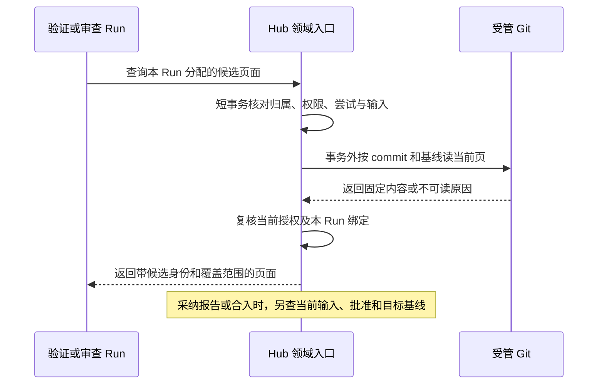

# CloudHelm Agent 与跨端接口架构细化方案

> 日期：2026-11-19（Asia/Shanghai）
>
> 性质：重构目标方案与执行指引。基于[原架构评审](2026-11-19-agent-architecture-review.md)，源码定位以 `dev / b226022483fc` 及评审时的工作树为参照。
>
> 本次重构按本文定义目标、依赖和验收。新架构只采用全新安装，退役旧架构的源码、已部署程序和运行数据，不做原地升级、数据迁移或旧版兼容。退役范围和切换步骤见 §1.1 与 §10.8。

**首选切片：让验证和审查 Agent 读取项目合并队列固定的最终集成提交。** 用户打开审查时，看到的源码要能与构建输入、验证报告和人类批准逐项对应；目标分支移动后，系统能说明旧证据仍证明什么、哪些步骤需要重做。先解决这个问题，再切换模型工具协议、重做 Desktop 读接口或调整 worker 队列。

[查看执行顺序](#9-执行顺序与并行边界) · [从 A00a 开始](#101-冻结首轮输入)

## 1. 重构范围与存量参照

保留 Desktop、Ops Hub、远程交付机三端。Ops Hub 内的控制面与开发执行区分属两个信任边界：Hub 管业务权限、证据索引和持久推进；开发 Runner 管工作区、测试、构建与预览的实际执行。Hub 仍是模块化单体，业务与 DBOS 同库分 schema，API 只接收命令和查询，唯一 DBOS worker 承担领域工作流。远程交付机的 Remote Agent 按批准计划取许可、执行有限步骤并留本机账本。

### 1.1 全新安装与旧架构退役

- **源码和发布制品。** 新实现交付时，从当前源码树移除被替换的旧实现、入口和部署定义。新制品不携带旧版实现，也不把它作为回退路径。
- **已部署程序。** 退役旧 Desktop、Hub、worker、Runner、Remote Agent 及本轮要替换的旧应用部署。确认停止后，卸载旧程序，移除其专属服务、容器、镜像和运行配置，撤销旧注册和专属凭据。新安装重新登记身份、绑定和权限。
- **运行数据。** 新安装从空库和空存储初始化。旧业务库、DBOS 状态、本机账本、旧部署专属数据卷、工作区、制品和运行备份在收尾核对后清理。新系统不导入旧数据、不挂载旧库、不保留旧数据的只读查询或回退副本。测试样例按固定输入重新生成。
- **接口与执行。** 不为旧 API、IPC、工具协议、执行协议或数据格式提供兼容层。旧 Task、Session、DBOS 工作流、等待、桌面未确认命令和 Operation 在原安装核对并收尾，不导入、续接或重放到新安装。新架构只启用实际验证过的组件组合。

清理限于已确认归属本轮退役范围的资源。仓库的 Git 历史、设计和验收记录只作历史参照。新架构自身的重启恢复、操作核对及受管项目的正常数据库迁移仍按各自契约执行。

### 1.2 存量证据参照

| 现有证据 | 本文如何使用 |
|---|---|
| [A11](../acceptance/p2/p2-5-02.md)有固定便签参照的真实单 Agent 修改、反馈和构建证据 | 作为改造前的功能参照。缺少完整账单与可比耗时，不能据此估算提速或降费比例 |
| [E07d](../acceptance/p2/p2-4-02-e07d.md)对最终提交构建制品，独立 HTTP 验收 50 项通过并获得人类批准、项目内合入 | 用来说明提交、制品、报告、批准的引用关系；该轮开发与最终树清单相同，不能单独检出候选读取误用开发提交 |
| [R05a / R05b 出口核对](../acceptance/p2/p2-r05b.md)验证真实报告绑定和隔离完成门禁 | 原 Task 仍有必需工作项阻塞。副本接受、合成停止回执与 E07d 不能拼接成一次真实 Task 完成 |

按新方案先做最终候选读链，再完成单 Agent 开发、复验、审查和交付闭环，最后加入双开发会话。旧阶段的补证和出口不决定这些切片何时开工。新链路的数据绑定、运行结果和支持组合在新安装中单独取证。

## 2. 以 WorkItem 为推进单元

### 2.1 启动前说明能做什么

从**安装已支持的能力、项目配方、当前主体权限、Task 策略**派生启动条件。以“修改便签查询，并按参照配方构建”为例，面板分别显示受管源码权限、匹配的构建配方、正式预览支持和是否要求人测。每项给出可用性、原因、证据或策略引用。若正式预览是本 Task 的必需条件，说明启动或完成将受哪条规则阻塞；若可选，允许其余已获准的工作继续。投影随安装和权限更新，业务状态仍由各领域命令裁决；UI 能力提示和模型配置均不授予权限。

### 2.2 固定输入，按证据解锁

在新调度里，WorkItem 是选择上下文、工具范围和验收依据的入口。进入一次推进前，应能回答以下问题：

| 问题 | 固定内容或权威来源 |
|---|---|
| 做什么，交什么？ | `task_id`、`work_item_id` 和工作项修订；目标、需求和验收修订；预期交付物及接受条件 |
| 可以读写哪里？ | 工作区、基础 commit、允许修改的路径和当前写入代次。有交还时固定交还快照与差异。路径范围仍由执行器在入场时执行 |
| 依赖什么？ | InputSet 固定契约修订、候选或制品版本、已登记的验证证据和环境条件。确认契约、可用产物、集成输入齐备、环境就绪各有不同解锁依据 |
| 由谁用什么额度推进？ | 当前主体及权限修订、Session 固定角色和工具协议、控制及输入有效性修订、批准的请求/费用/时长上限 |
| 谁能接受？ | `collaboration` 检查工作项及 Task 完成门槛，消费 `integration` 维护的候选、验证、审查和适用性事实。模型能提交引用和建议，有权者通过现有业务命令批准 |

只在真实依赖满足时解锁对应工作项。比如前端工作项只依赖已生效的接口契约，就可以先实现交互；联调工作项依赖双方的确定产物和环境观测，收到另一个 Agent 的“已完成”消息还不能解锁。契约修订时沿明确引用查消费者，先把无法确认兼容的证据标为需复核，再决定哪些工作受影响。该结论不会改写原报告。

### 2.3 角色边界

| 角色 | 输入与输出 | 写入边界 |
|---|---|---|
| 协调 | 由需求、契约、依赖与预算给出拆分和返工建议，所有建议引用当前版本 | 可提出业务命令，由协作域校验；不直接改工作项或目标引用 |
| 开发 | 按范围修改工作区，交开发自测、冻结候选及已知缺项 | 只写当前分配且持有写入权的范围；独立验收资产归受控来源 |
| 验证 | 对固定候选与制品执行按版本固定的方法，交报告引用、实际失败/缺项/未知 | 候选只读；通过来自确定的执行事实 |
| 审查 | 读最终候选差异及上下游证据，交问题位置、理由、影响与未覆盖范围 | 可以提出返工，批准和合入使用有权人类的入口 |
| 运维 | 按实际运行版本和观测窗口交调查建议、修复输入或受限处置建议 | 按安装支持、策略和授权开放；应急启用和恢复判定各有权威来源 |

默认使用单开发 Session。先验证新单 Agent 主链，再接多开发会话；并行开发要求契约可固定、写入范围可分、产物能单独交接、总预算和物理资源允许。同一 Session 同时只有一个有效 Run。新安装从新建的 Task 和 Session 开始推进。

## 3. 首个切片：读取最终集成候选

### 3.1 事实、输入与基线

[构建读取](../../modules/integration/merge_builds.py#L31)已核对队列条目、当前尝试、Task 控制/输入修订及来源，并在事务外从受管 Git 按指定提交读取整树、核对清单及文件摘要。[验证与审查的源码读取](../../services/hub-worker/engineering_verification.py#L72)只打开工作区冻结回执，明确拒绝 `integration-candidate-` 来源。这是首切片要补的接缝。

| 来源 | 解析固定对象的依据 | 源码差异的比较基线 |
|---|---|---|
| 工作区冻结 | Task 下的候选、原冻结 Operation、执行器回执、固定 commit 和清单 | 工作区冻结时登记的父提交 |
| 最终集成 | 项目、队列条目、准确的集成尝试、受管 Git 来源、最终快照和 InputSet | 尝试的 `base_commit`，即该次准备时的目标提交，等于快照 `parent_commit` |

特别区分集成尝试的 `candidate_commit`（进入队列的开发提交）与快照的 `candidate_commit`（已准备的最终集成提交）。[现有审查上下文](../../modules/agent_runtime/review.py#L22)还区分 Task 的 `source_input_set_ref`、固定候选自己的 `input_set_ref`，以及验证报告对其方法、资产和环境冻结的输入引用。它们需要按记录串联核对，不要求三个 InputSet ID 相等，也不因树清单相同而替换提交或输入身份。

### 3.2 窄读接口

沿用验证/审查现有候选工具，首版无需新增公开路由。Gateway 从 Run 的已分配候选推导仓库和准确身份，模型只提供该工具允许的路径、范围和分页参数。内部解析结果可用两种来源的读规格表示，公共字段包含 Project/Task/候选引用、固定 Git 来源、提交、基线、清单摘要、输入引用；集成来源追加队列条目与尝试。由构建与读侧复用**已登记来源与内容核对的规则**，构建仍按自身需要取整树。

实现落点：`modules/integration` 负责从队列事实解析集成候选；[审查 Gateway](../../modules/agent_runtime/review.py#L97)和验证入口负责 Run/角色与所分配候选的检查；`engineering_verification.py` 负责按读规格取页。先对齐这三处接口再替换现有拒绝分支，继续使用当前的候选与 Git 证据记录。

| 动作 | 输入与读取方式 | 返回 |
|---|---|---|
| 列目录 | 对固定清单按目录和稳定顺序分页 | 路径条目、下一页位置；不加载整树内容 |
| 读文件 | 规范化候选内路径；按清单定位 blob，在既有读取限额内核对实际长度和摘要 | 内容片段及范围、文件摘要、是否截断或无法展开 |
| 读差异 | 比较固定基线和最终提交的清单/树，只展开当前页所需的 blob | 文件增删改、对应位置、受限补丁、未覆盖原因和下一页位置 |

每页带同一候选标识、commit、基线和清单摘要。沿用现有工具的边界校验、秘密路径和展示脱敏。二进制、过大或无法安全展示的内容只提供获准的覆盖信息，不把空片段显示为“已审查、无变化”。分页继续用绑定候选和查询条件的位置；候选或条件变了就从新查询开始。Git 对象丢失、清单不符、权限不足时明确返回不可读或不可用，禁止回退到当前分支头、开发提交或可变工作区。

### 3.3 读取与采纳是两次判断

- **当前审查**：保留角色、Run 和所属 Task 门禁，读取 Run 绑定的准确候选。绑定在读取期间失效时，不以旧页面支持当前审查。Agent 不能通过模型参数跨 Task、跨项目读取。
- **历史审计**：若后续开放，按当前读取权限查询新安装内已登记的准确尝试；被替换的尝试仍可在 Git 对象保留时解释历史。首切片不增加历史入口，也不把构建的“允许创建新物理操作”作为历史读取门槛。
- **结果采纳**：审查问题绑定候选、尝试、文件位置及证据，已有验证报告还要核对构建 Operation、来源和制品。合入命令重查当前尝试、报告适用性、人类批准及实际目标旧 SHA，有条件更新目标引用。旧尝试可读、原报告曾通过，均不授权用它批准新尝试或完成 Task。

**可审查的验证样例。** 在隔离受管 Git 中从 B0 生成开发提交 D1（修改便签查询）；目标从 B0 前进到 T1（单独增加辅助文件）。队列准备 M1 后，读取 M1 可见辅助文件，D1 看不到；差异比较 T1→M1 只包含这次开发贡献，不把目标分支自己的辅助文件列成提交修改。用同一 M1 对应的构建输入核对读取身份。当目标再前进至 T2 并生成 M2，旧 M1 及其报告仍是历史，不能用于 M2。再用一个越出读权限或不可安全展示的输入验证边界。这组输入专门区分错误来源、错误基线和旧尝试复用。

## 4. Agent 的推进、事务和记名工具

### 4.1 Run 与 Operation 的交接

一次 Run 的结果可以是提交候选、推进额度用完、登记等待或明确失败。Session 保存合法历史边界；Run 崩溃恢复仍用原 `run_id`，可靠等待解决后的续接使用新 Run。真实模型出站各自有 `ModelRequestRecord`，真正的构建、工作区变更等有自己的 `operation_id`；两者不因 Run 续接而换身份。

例如，开发 Agent 提交构建 B1，得到 `accepted` 后可继续无依赖事项。调用等待时，若已知确定结果，返回证据；否则在同一短事务保存消息历史边界、原 `tool_call_id` 与等待、Run 终态及后续推进依据。这样释放模型槽，构建仍按真实占用计账。已到达的结果在登记等待时一起核对；晚到的结果按原 Operation 保存，只有当前权限、输入、控制、工作项和 Session 资格允许时才可靠入队且只续接一次。暂停积累事实，完成或取消后晚到事实只归档。B1 的物理结果未知时继续核对，不能伪造失败供模型另开 B2。

### 4.2 上下文准备的事务边界

[Runtime 装配入口](../../modules/agent_runtime/application.py#L93)在业务事务内加载历史和上下文并触发 Git 读取；[Desktop 工作区差异](../../modules/agent_runtime/task_entry.py#L90)已有“取读规格 → 事务外读取 → 复核”的本地先例。建议按可分的切片处理：

1. **短事务固定读取依据。** 核对当前 Run 和权限，收集任务/工作项、候选或工作区读规格、commit、InputSet、控制/输入/权限修订及历史摘要。只记录小型引用和必要的业务事实。
2. **事务外读取内容和装配。** Git 按固定 commit 或现有可核对的受控读规格访问；人工交还按固定快照取差异。按已提交摘要和大小边界装配历史及上下文。若工作区在读期间变化且无法证明仍是原版本，停止该轮组装并说明原因。
3. **实际出站前重新准入。** 沿用 [RuntimeAdmission](../../modules/agent_runtime/admission.py#L67) 核对当前资格、绑定修订和预算，每次真实请求登记后才发送；若撤权在准入检查前已提交，不产生新的模型请求。已登记且可能出站的请求仍按原请求和供应商事实核对。工具副作用各自在执行边界检查当前业务资格。

稳定部分保存角色约束、工具修订和项目规则；变化部分按工作项引用最近反馈、差异和必要证据。沿用当前最终 prompt 64 KiB 和业务 SDK 历史 256 KiB 边界；跨角色传引用和简明事实，保留未完成工具批次所需的完整历史。超出边界时明确交接。若未来引入模型压缩，也通过实际请求记录与费用门禁。

### 4.3 先建工具时间线，再启用记名工具

现有 [Gateway](../../modules/tool_gateway/gateway.py#L24)向模型暴露 `dispatch_tool(name, arguments)`，[工具时间线](../../modules/agent_runtime/task_queries.py#L46)也只从该外层名提取业务动作、返回及校验重试。延期工具的结果可能在**续接 Run**才入历史，但仍以原调用 ID 和原 Operation 关联。只改注册会让新工具从 Desktop 历史里消失。

| 切换步 | 应交付的行为 |
|---|---|
| 先接新工具的展示 | 时间线按 Run 固定的工具协议和业务动作归类。按原调用 ID 关联调用、返回和重试，保留时间线所在 Run 与原调用的关联 |
| 用现有只读工具试开新 Session | 单个工具定义业务动作、模型名、参数类型、角色上限、是否只读/需持久交接及现有处理入口。比如 `workspace.read_file → workspace_read_file`。可见集合是安装能力、角色、工作项范围和当前授权的交集 |
| 接入写入与延期工具 | 按业务动作规范化请求并执行批次限制；只读最多每批 8 项，写入、提交和等待按各自规则单独处理。SDK 边界校验结构一次，领域继续检查授权、路径、版本、写入代次与预算 |

新安装只注册记名工具。接齐新工具后，移除 `dispatch_tool` 及其旧时间线解析。新安装内的延期结果仍按原 Run、调用 ID 和 Operation 核对，旧安装的等待按 §10.8 收尾。

每个真实模型尝试（包括重试、参数修复触发的新请求）按同一准入记账。已知计算费用、未知预留和供应商账单分开。对 `query_operation` 的无进展判断，只比较操作、可确认业务状态、结果修订和证据等业务信息；`observed_at` 留作观察。只变观察时间的重复查询应消耗推进额度并触发既有交接规则；确认新状态、结果或证据时才算有进展。

## 5. Desktop 与 Hub 的接口

### 5.1 摘要、单轮明细和代码视图

当前 [Agent 面板查询](../../modules/agent_runtime/task_queries.py#L89)展开最多 8 个 Session、每个最多 8 个 Run 的相关 SDK 历史后再裁剪输出。新查询先定义具体的 Pydantic 响应类型，再按固定 OpenAPI 生成 TypeScript。Desktop 接入摘要和明细后，同步移除旧聚合路由、响应类型和对应调用。

| 接口 | 状态 | 首版契约 |
|---|---|---|
| `POST /api/tasks/{id}/agent-runs` | 保留 | 保留工作项、可选原 Session、Task/控制/输入有效性修订、Session 版本及预算约束。服务端装配角色、工具与输入；回执只说明命令结果及 Run 引用 |
| `GET /api/tasks/{id}/agent-summary` | 拟新增 | Task 和可见工作项，相关 Session 修订和最近 Run 摘要，等待/阻塞原因，费用摘要及截断或分页标记。读领域记录与有界聚合，SDK 历史读取数为零 |
| `GET /api/tasks/{id}/agent-runs/{run_id}` | 拟新增 | 先按当前权限核对 Task→Session→Run 归属。返回该轮状态、终止原因、工具时间线、请求记录摘要、等待、Operation 和证据引用，仅加载重建此轮所需的历史边界 |
| `GET /api/tasks/{id}/agent` | 移除 | 由摘要和单轮明细取代，旧路由不进入新安装 |
| 可变工作区 diff / 固定候选代码 | 分开 | 前者用于看当前开发差异，标工作区版本；后者用于正式审查，标最终 commit、基线及覆盖范围。首切片先接现有 Agent 候选工具；需要 Desktop 入口时复用同一读规格 |

费用金额使用契约约束的十进制字符串，未知字段保留为空，已知小计与未知请求数量分开呈现。明细传脱敏、限长的工具摘要与引用，不传完整 prompt 或 SDK 历史。若单轮解析仍昂贵，再以实测决定是否投影展示事件；首版不为列表引入同步历史副本。

### 5.2 原生命令回执

目前 [Rust bridge](../../apps/desktop/src-tauri/src/bridge.rs#L141)和 [React](../../apps/desktop/src/useHub.ts#L13)都从响应体推断命令是否登记。首版改 IPC：Rust 确认 Hub 的命令身份且本机日志已持久化后，返回明确的可选 `receipt`（原 `command_id`、幂等键、HTTP 状态及已有业务结果）。React 不再解包响应推断是否清理，只展示并确认已展示。未确认的命令继续保留原幂等键和正文；重新连接时按原范围重投并重新授权。若以后统一 Hub 回执信封，该工作单独换版，不作为 IPC 改动前置。

| 情况 | 本机和界面行为 |
|---|---|
| 确定受理（含 `202`） | 持久回执后展示“已接收”，从原 Run 或 Operation 查询最终状态 |
| 业务拒绝已持久登记 | 以同一命令身份保存拒绝回执，展示具体原因；凭据错误、请求未登记等情况不冒充业务回执 |
| 传输中断或本机持久化未确认 | 保持待核对，重新授权后，同键同摘要取得原结果；同键异摘要明确冲突 |

### 5.3 SSE 刷新合并与原生预览

[Desktop 同步入口](../../apps/desktop/src/useHub.ts#L97)已区分新范围的快照游标与已有范围的消费游标。首版按账户、项目、流身份和权限修订维持**一个在途快照请求**，普通事件/回执/手动刷新合并为一个待刷新标记。在途期间收到新触发，结束后按仍有效的范围发一次尾随刷新。已明确只影响某个 Task 或 Run 时只使对应视图失效；范围变化、事件缺口或未知影响才重建快照。

新范围从一致性快照游标订阅。同范围刷新不能用快照游标跳过已接收但未消费的事件；重连沿最后实际消费的游标，按聚合版本去重。账户、项目或权限范围切换后，旧响应不可回填。撤权或预览关闭走现有控制路径，先本地清理、收窗；不排在普通刷新后。服务端查询、命令及 SSE 重鉴权继续以当前权限为准。

[人测选项](../../services/hub-api/routes_previews.py#L38)当前从最近一轮环境取管理入口，新版只返回可测候选和测试者。用户选定准确轮次后，以其 `environment_id` 进入原生 `preview_open`，打开前重新授权。票据经受保护的管理页签发和原子兑换，不进 URL、命令回执或日志。界面分别显示撤销已请求、本机收窗、专用分区删除和全部相关代理已确认断开；缺少最后一项证据保持待确认。Edge 用于辅助检查，原生能力隔离、开窗和收尾使用实际 Tauri/WebView2 取证。

### 5.4 版本切换

隔离新安装直接验证成套的 Hub 和 Desktop。原生握手核对准确的 API schema，Desktop 路由、IPC 受限白名单和生成类型随新契约一起交付。旧客户端不能连接新 Hub；旧 Desktop 未确认命令在旧安装按原键核对并收尾，新客户端从空日志开始。API schema、工具协议、DBOS 应用和执行协议各自独立版本化。

## 6. Runner 与 Remote Agent 的接口

### 6.1 首先固定开发构建接缝

[目前的构建入口](../../services/hub-worker/engineering_build.py#L115)由唯一 worker 调用本机构建执行链；[资源操作](../../services/dev-runner/resource_channel.py#L12)另走固定 Unix socket。先在本机 light 接已有实现，给构建划出以下语义边界，再根据独立 Runner 的证据决定传输方式。

| 动作 | 输入 | 返回与责任 |
|---|---|---|
| `submit` | 原 Operation 与规范摘要、固定构建输入、资源预留、执行器绑定及代次 | 持久接收回执绑定原身份。同身份同意图查询原结果，异摘要拒绝。只有具备可靠接收与查询时才能单独返回异步受理 |
| `inspect` | 原 Operation，按当前授权和绑定查询 | 原物理尝试、观察状态、结果/制品引用或待核对原因。“无记录”不能单独证明旧进程已停 |
| `request_stop` | 原 Operation 和代次，按现有控制权限发起 | 请求停止的回执与实际停止证据分别记录。已停止后才释放相冲突的进程额度；磁盘按已回收或连续转入保留额度结算 |

Hub 持有队列和资源准入，执行器在接受及启动前核对代次、预留和当前资格，再记物理事实。现有本机调用尚不能拆分的步骤保持原来执行方式；不能后台丢任务并假报受理。未来接独立 Runner 时，另验身份、受控传输、同宿主共账、启动门禁、重启按原身份找回及停止回执；适配器存在不构成跨主机能力。

### 6.2 远端八个操作保持原分工

`bindings/observations` 报告绑定和观察；`poll/artifacts` 取准确的批准计划与其制品；`sample/permits` 固定可信时间并逐个新步骤在线取许可；`results/closeouts` 分别上报步骤实际结果与整个原操作的封闭或停止证据。开发执行操作不经这条交付通道。

[Hub 远端入口](../../modules/delivery/remote_http.py#L74)已返回有限的结构化 `code`；[客户端](../../services/remote-agent/channel.py#L46)把非 200 POST 多数折叠为等待许可。首版在现有的响应大小边界内只解释经认证通道的已知错误码，按下表给出维护动作，未知响应给出受限的通道或协议错误，不转显原始正文。

| 典型返回或现象 | 应给出的维护动作 |
|---|---|
| `remote_authentication_failed` | 身份当前不可用，提示有权维护者核对登记与绑定，禁止新启动 |
| `remote_request_invalid` 或 `remote_message_too_large` | 修正客户端请求或核对是否使用已验证的版本组合；原请求未被确认为新操作，不无限重投 |
| `remote_gate_unavailable`、计划摘要冲突或上一执行未核对 | 按原因核对时间、计划及现存本机账本；不得解释为“重开一个计划重试” |
| `remote_channel_unavailable` 或连接不可达 | 暂不可用；重连后按原身份查询/补报。既有执行意图仍按该计划的安全边界收束 |

交付项目的数据库迁移已开始但丢失回执时，按原 Operation、具名步骤、本机账本、实际数据库修订与后置检查核对。未知就阻止互斥新动作；不重新迁移或自动回滚。A→B 已改变实际环境时，从 A 批准的 A→C 必须重新固化基线和计划、取得批准。用户侧分别显示 Release 制品、配置修订、计划批准、目标执行结果及业务探测；Incident 的通知接收、人员确认和持续恢复按各自证据显示。

## 7. 容量与资源：先减持锁和无效工作

同机 light 规划为 4 vCPU、8 GiB；常驻平台 2 GiB、系统和缓存 1 GiB、突发余量 1 GiB，开发执行共享上限 4 GiB 和 3000m CPU，还受宿主实测可分配量约束。模型全局设计上限 3、活跃开发 Task 上限 2、共享宿主初期重执行上限 1、按需预览上限 1。[现有 worker](../../services/hub-worker/runtime.py#L66)的 models 队列并发为 1，单 Run 的默认请求额度为 3；这两项与全局设计上限分别处理。

[资源组准入](../../modules/execution/commands.py#L58)目前在池锁内读取整池历史并解析分配 JSON，存储冲突判断还会逐条读取 Runner。建议先用已有唯一 `operation_id` 精确判断身份，再取当前仍占账的分配及存储冲突所需记录。事务保持共享池的原子准入与冲突判定。已释放历史不参与容量求和，但仍保留去重依据；不能遗漏 reserved、active、releasing、orphaned、保留占用或未知上界。先对现有数据形状做有界查询；是否新增索引由固定历史量下的查询计划决定，不预增表或索引。达到队列空闲也不能跨过资源门禁。

例如，某宿主扣除固定保留后的可分配内存为 3600 MiB，已有 1500 MiB，占账中未覆盖的未知上界为 200 MiB，新申请 2200 MiB。3900 MiB 超过限额，即使队列空也应等待。各维度的有效容量取配置预算与实测可分配容量的较小值，再扣除只在容量侧计量的占用。同一未知用量只在账本或容量侧扣一次；没有可信上界时阻止相关维度的新准入。流程完成、租约到期、请求停止均不能单独回收物理占用。

先验证事务外 Git 读取、Agent 摘要不读历史、事件突发合并刷新、容量准入不加载释放历史。只有固定混合负载表明单槽 engineering 队列的长构建阻塞无关短操作，才为同一 worker 评审单槽长构建队列。拆队列后宿主资源账本共用，重执行额度不增加；等待人的决定、模型结果或原 Operation 的确定回执不占物理重执行槽。

对比同一环境、输入及缓存条件，定向记录锁持有时间、相关读取行数、SDK 历史读取量、快照请求次数、控制响应和排队时间。容量验证分别取证同机 light 和独立 Runner，包含全链资源、控制 P95、连接池、磁盘/制品残留及至少 24 小时持续观察。性能阈值和统计窗口在运行前固定；定向行为检查不替代整机容量验证。

## 8. 多 Agent 协作样例

需求是“便签列表支持按标签筛选；未传标签时保持原结果”。用四类工作项表达顺序，不以聊天消息代替依赖：

| 工作项 | 可开始的依据 | 交付及解锁 |
|---|---|---|
| 契约 | 已确认需求与验收修订 | 固定无标签、已知标签、未知标签语义；正式断言由独立来源登记 |
| 后端、前端分别实现 | 契约生效，写入范围、预算和工作区可分 | 分别交精确的候选与开发自测。前端可先按契约实现，联调才需要后端实际产物 |
| 集成与正式验证 | 两份产物有效、环境就绪、独立方法固定 | 如果两侧必须一起交付，由专门的集成工作项形成组合候选，再经项目队列生成最终提交；不依赖现有队列自动合并多个未完成条目 |
| 审查与接受 | 最终提交及相应制品、报告可读且适用 | 审查按最终差异给问题；返工形成新候选，再验证受影响条件。有权审查、合入和工作项接受分别走各自入口 |

若单标签改为多标签，只影响引用旧契约且无法证明兼容的消费者；前后端按各自确切引用重新准备，队列为新输入取得新证据。基础镜像变了，重判制品证据与受其影响的验证；源码审查按自身精确输入与范围另判。生产配置或秘密版本变了，重新固定相关计划与批准；无需仅因这一点重建未变的制品。Task 完成时，同一事务复核必需项、适用证据、人测策略、版本与未收尾写入。

新单 Agent 主链通过后再跑协作对照。实验前固定任务、变化触发点、判定方法和开始/停止条件。隔离轨迹比较两种依赖判定规则，用独立真值评估错误解锁和错误阻塞。真实单/双开发会话对照保持同一证据门禁、模型/工具、初始输入、总预算、总物理资源和人工规则；独立记录通过率、返工、排队、主动人工时间和已知/未知费用。失败和未完成进入原始记录，轨迹上的判定差异不直接换算为实际节省。

## 9. 执行顺序与并行边界

**先固定新输入，再形成一条可端到端验证的路径。** 主线为：**A00 冻结样例 → A01/A02 最终候选可读 → B/C/D 三组接线 → G01 新单 Agent 闭环 → E01/E02 双开发协作 → G02/G03 容量验证与切换**。

**编号规则：** `A00` 是工作包，`A00a`、`A00b`、`A00c` 是可单独分派的步骤。分派、反馈、验证和交接都引用完整步骤号。跨工作包按下表的依赖推进；新增步骤使用未占用编号，不重排已有编号。

| 路线 | 组内顺序 | 并行与汇合条件 |
|---|---|---|
| 最终候选 | A00 → A01 → A02 | A00a 是第一步；A02 的固定提交和读结果留给后续各组复用 |
| Agent 与工具 | B00 → C01 → B01 → B02 → B03 → B04 | A02 通过后开始 Runtime 接线。写入和延期在 B02 验证通过后开放 |
| Hub 与 Desktop | B00、B01 的字段稳定 → C02 → C03 → C04 → C05 → C06 | C02 可与 B02～B04 并行；C03～C06 按表顺序集成，避免同时改原生桥或界面状态入口 |
| 执行端 | D01 → D02；D03 独立；D04 按发布范围在 D02 后做 | A00 固定资源输入后可并行进行。D02 先接本机；需要发布独立 Runner 才做 D04，可与本机 G01 并行准备 |
| 产品验证与切换 | G01 → E01 → E02 → G02 → G03 | G01 使用 A02、B、C、D 合入后的同一版本。若只发布单 Agent 范围，跳过 E01/E02，容量与切换仍按实际发布范围验证 |

可以并行准备样例与测量环境；同一文件、同一权威记录或同一物理宿主的重任务按依赖串行。每个编号交付自身接口、一个能识别关键错误的定向验证，以及转交下一步的准确引用。下文是实施顺序和预期；实际开工与结果分别记到 `PROJECT_PLAN.md` 和 `PROJECT_PROGRESS.md`。

## 10. 逐步执行手册

### 10.1 冻结首轮输入

**A00｜准备验证输入（主负责人和独立验收负责人）。**

1. **A00a｜记录基线、建立隔离安装。** 记下源码基准、指定的开发分支与现有改动。后端、Git、数据库和执行端在 WSL；原生 Desktop 在 Windows。隔离安装从空库初始化，不从旧环境导入 Task 或运行数据。既有宿主可在核对归属后使用独立命名空间；旧安装退役按 G03 执行。
2. **A00b｜固定候选读取样例。** 准备 §3.3 的 Git 提交样例，记录准确 SHA、树清单摘要、候选/尝试 ID、InputSet 引用和独立断言来源。第一组输入必须有**只在目标提交存在**的文件，才能证明没有误读开发提交；目标再次移动是单独的失效条件。
3. **A00c｜固定任务与操作账本样例。** 准备一个带人工交权、反馈返工和实际可交付目标的单 Agent 任务，以及成功、停止、结果未知三种操作事实。记录 Hub、SDK、构建配方、客户端和执行器版本。先写清正向与失败预期，验证方不从被测代码推导独立断言。

**交付：** 一页输入与预期对照表，含确切来源、负责方和待定环境。表冻结后开始 A01a；原生环境和独立目标未就绪只阻塞对应验证。

### 10.2 A01 → A02：最终候选读链

**A01｜固定读规格（集成）。**

1. **A01a｜列出两种来源的权威字段。** 对照 [集成候选解析](../../modules/integration/merge_builds.py#L31)和 [现有候选读取](../../services/hub-worker/engineering_verification.py#L72)，分别列工作区冻结依据、集成条目与尝试、存储/Git 来源、候选 commit、目标基线、清单摘要和 InputSet。
2. **A01b｜实现固定读规格。** 当前审查的可读资格与允许新构建的准入分开。集成候选缺尝试、绑定不一致或 Git 来源未注册时返回明确错误。把固定读规格交给 A02a，构建接口继续取自身所需的整树。

**A02｜接通候选工具（Worker 与 Runtime）。**

1. **A02a｜接目录页。** 在 `engineering_verification.py` 按固定读规格打开 Git 对象，从清单列目录；Workspace 与集成来源都用准确身份。
2. **A02b｜接限长文件读取。** 按清单定位 blob、检查长度和摘要，返回范围片段或无法展示的原因。
3. **A02c｜接分页差异。** 比较固定基线与候选，计算增删改，只展开当前页内容。
4. **A02d｜接验证与审查入口。** 在 [VerificationGateway](../../modules/agent_runtime/verification.py#L118) 和 [ReviewGateway](../../modules/agent_runtime/review.py#L93) 短事务取规格、事务外读取、响应前复核当前绑定；工具参数不选仓库或提交。
5. **A02e｜核对最终源码和证据引用。** 用 A00b 调用目录、文件和差异：M1 能看到 T1 独有文件，M1 差异不把该文件列作开发修改；目标移动后，旧 M1 不可用于当前接受。补一个错作用域或不可安全展示的读取。Git 视图改动配合 `python -B -m scripts.p1.check_workspace_git`。

**停线条件：** 构建、读侧、报告身份对不上或读请求回落到可变分支时，回到 A01b 或 A02 对应步骤。修复后重跑同一输入，已冻结的旧报告不重写。

### 10.3 B00 → C01 → B01 → B02 → B03 → B04：Agent 以工作项推进

**B00｜固定工作项入口（协作）。**

1. **B00a｜装配单轮读规格。** 固定目标、路径范围、需求/验收修订、四类依赖、输入、预算和写入代次。
2. **B00b｜接启动与续接准入。** 一次核对身份、当前授权、版本、依赖和预算，同事务登记 Run 与工作流入队。验证已有有效 Run 不重复入队，缺少必需产物的工作项不能运行。
3. **B00c｜投影可用能力。** 把安装能力和工作项必需条件投影给 C02；验证可选能力缺失不阻塞无依赖工作。

**C01｜拆上下文事务（Runtime）。**

1. **C01a｜从事务内提取读规格。** 在 [Runtime 应用](../../modules/agent_runtime/application.py#L93) 和 [上下文装配](../../modules/agent_runtime/context.py#L98) 固定数据库读取依据与相关修订。
2. **C01b｜迁出 Git 和内容装配。** 事务外加载源码、交还差异和上下文；实际 HTTP 出站前核对当前修订及预算。同一输入的装配引用应一致；在出站准入前撤权，请求计数不增加。

**B01｜接工具时间线（Runtime 查询）。**

1. **B01a｜投影新工具动作。** 在 [工具时间线](../../modules/agent_runtime/task_queries.py#L46) 按声明映射成功、隔 Run 返回和校验重试；保留调用归属，隐藏原始错误输入。
2. **B01b｜核对新工具历史展示。** 用固定记名工具消息验证调用、跨 Run 的结果与校验重试按原调用身份关联，保持已提交 SDK 历史的原样。

**B02｜接记名只读（Gateway）。**

1. **B02a｜登记首个记名工具。** 在 [Gateway 注册](../../modules/tool_gateway/gateway.py#L24) 先接一个已有只读动作，从同一声明得模型参数和展示动作。
2. **B02b｜用试用 Session 核对入口。** 固定工具版本，检查批次、当前权限和展示；固定协议输入应覆盖可调用和无权拒绝。尚未通过时暂停试用入口。

**B03｜接写入和延期（Gateway 与工作流）。**

1. **B03a｜接写入代次。** 先接有写入代次的文件命令，验证旧代次不能写。
2. **B03b｜接可反查的操作提交。** 提交与查询绑定原 Operation；同一提交只登记一次，受理回执允许继续独立工作。
3. **B03c｜接按需等待。** 只在确定结果且资格有效时续接一次。用固定历史与原回执验证丢失或晚到结果按原身份核对，未知不唤醒。真实模型闭环留给 G01。

**B04｜关闭无进展循环（Runtime）。**

1. **B04a｜改用稳定业务比较。** 在[有界开发循环](../../modules/agent_runtime/development.py#L11)比较同一 Operation 的业务状态和证据，只变观察时间进入无进展交接。
2. **B04b｜核对停止边界。** 固定输入覆盖重复查询、状态推进和额度用完，达到预算边界不得隐式续费或另建 Run。

**必须保留的输出：** 生效的 WorkItem/Run 字段、读规格、工具版本和原 Operation 引用；C02 不依赖完整会话历史拿这些字段。B03 不通过时可以继续验只读与 Desktop，写入和延期保持未开放。

### 10.4 C02 → C03 → C04 → C05 → C06：把新行为接进 Desktop

**C02｜Hub 契约。**

1. **C02a｜定义摘要和单轮类型。** 在 [Agent 合约](../../packages/contracts/p2/task_agent.py) 固定 WorkItem、Session/Run、等待、费用摘要和详情字段。
2. **C02b｜接路由和查询。** 在 [Agent 路由](../../services/hub-api/routes_agent.py) 用当前权限查询可见摘要，详情只取有归属的单个 Run。
3. **C02c｜核对契约与读量。** 更新 OpenAPI，跑 `python -B -m scripts.p1.check_public_contracts`；另验证列表不读 SDK 历史、跨 Task 读 Run 被拒绝。

**C03｜Desktop 读链。**

1. **C03a｜生成类型并接原生路由。** 使用 C02 的固定契约，扩充受限 [Rust 路由规则](../../apps/desktop/src-tauri/src/security.rs)。
2. **C03b｜接列表和单轮明细。** 修改 [Agent 面板](../../apps/desktop/src/AgentPanel.tsx)，列表仅加载摘要，打开 Run 才查详情，请求携带当前范围标记；移除旧聚合接口及其两端调用和类型。
3. **C03c｜验证同版组合。** 在 Windows 构建前端，用同版 Hub 和原生客户端确认两类请求正常且预览窗口无管理 IPC。

**C04｜命令回执。**

1. **C04a｜接原生持久回执。** 在 [Rust bridge](../../apps/desktop/src-tauri/src/bridge.rs) 本机日志持久化后才发布确定回执。
2. **C04b｜接界面展示与确认。** 在 [useHub](../../apps/desktop/src/useHub.ts) 消费显式回执。检查原键重投、已登记业务拒绝和响应丢失，确保不会重复执行、误清本机记录或把受理当成功。

**C05｜同步去重。**

1. **C05a｜按范围合并在途快照。** 在 `useHub.ts` 接事件失效与尾随刷新，撤权到达时先处理关闭行为。
2. **C05b｜验证事件突发与重连。** 同范围最多一个在途快照，按最后消费游标恢复，旧范围回包不可覆盖新界面。若改了服务端同步行为，再按需跑 `scripts.p1.check_sync` 的隔离入口。

**C06｜预览入口。**

1. **C06a｜固定选项合约。** [Hub 路由](../../services/hub-api/routes_previews.py) 只返回可测候选和测试者。
2. **C06b｜按准确轮次打开。** 连接 [人测面板](../../apps/desktop/src/HumanTestPanel.tsx) 和必要的原生入口。用不同候选的两轮环境核对开对窗，切轮或撤权后旧入口不可用。以 Windows Tauri/WebView2 的原生结果为准，Edge 用于辅助。

**停线条件：** 新 Hub/Desktop 配对未通过时，停止开放对应入口，修复并重验同版组合。新安装内未确认的命令按原键核对；不切回旧版，也不清空新日志绕过对账。

### 10.5 D01 → D02 → 按需 D04，D03 独立：收紧物理执行接缝

**D01｜缩小宿主锁内查询（资源）。**

1. **D01a｜分开身份查询和容量计算。** 在 [资源命令](../../modules/execution/commands.py#L58) 按原 Operation 去重，再按宿主池、占账状态和实际存储冲突键裁剪容量参与项，保留同池原子记账。
2. **D01b｜比较历史量和占账。** 用相同有效分配、不同释放历史量比较读取行数和准入结论；加一个保留或未知占用改变结论的例子。依据只读查询计划决定是否需要索引。

**D02｜接本机构建边界（Worker/Runner）。**

1. **D02a｜提交前绑定原身份。** 从 [构建 Worker](../../services/hub-worker/engineering_build.py#L115) 与 [本机构建执行器](../../services/dev-runner/engineering_build_runner.py) 接 `submit`。先核对原身份和预留，再交接执行；不能证明可靠接收时保留同步交接。
2. **D02b｜反查并停止原尝试。** 接 `inspect/request_stop`，核对物理状态和制品。验一次正常执行与一次请求停止：停止前资源不释放，接收或停止未知时不启动冲突操作。

**D03｜解释远端结果（交付）。**

1. **D03a｜映射错误码与处理动作。** 从 [Remote 客户端](../../services/remote-agent/channel.py#L46) 接 [Hub 错误结构](../../modules/delivery/remote_http.py#L74)，区分重登记、修正输入、原计划核对和重连；沿用现有传输。
2. **D03b｜验证同操作重连。** 断线后不重取已开始步骤的许可，不另建计划；迁移事实仍从实际数据库和原账本确认。

**D04｜接独立 Runner（仅在要发布独立档时）。**

1. **D04a｜接受控传输。** 基于 D02 契约绑定 Runner 身份、可用宿主池、代次和制品摘要；开发 Runner 不使用 Remote Agent 的部署权限。
2. **D04b｜接结果交回和停止。** 先确认提交后可反查，再按原身份交付结果、停止和取制品。
3. **D04c｜验证独立主机重启。** 跑一次实际独立构建，在受理后重启执行端；应能查回原尝试，冲突资源不重复入场，制品按原摘要取回。容量由 G02 分档验证。

**汇合前：** D02b 不能反查时不开独立 Runner；D03b 至少要证明原计划可核对才能接真实交付。拆工程队列和提高并发只在 G02 的固定负载证明有需要时再单列。

### 10.6 G01：跑通新单 Agent 主链

以 A00c 的单 Agent 任务为输入，使用同一集成版本的 Hub、Worker、Runner 与 Desktop。此处跑真实模型、Git、构建和独立验收，使用已经确认的实际预算和范围。按以下顺序留证：

1. **G01a｜启动任务。** 选定需求、验收修订和安装能力；固定 WorkItem、限制和 Session。由 Desktop 提交，保存原命令及 Run，确认面板能看到预算、阻塞和实际推进。
2. **G01b｜开发与人工交还。** Agent 完成一轮修改及自测。执行器确认交出旧写入权后让人类修改，交还时登记新代次和快照；确认旧 Run 无法写入，新 Run 消费交还差异。用真实失败反馈或审查问题触发一次修复，再按新候选重验。
3. **G01c｜形成并验证最终候选。** 冻结开发候选，项目队列按准确目标 SHA 准备最终提交；执行器构建该最终提交，独立方按固定资产验证制品，审查读取同一最终候选。
4. **G01d｜按策略验收人测。** 选中人测时固定轮次与环境、记录人类结论，并核对授权撤销、实际停机与占账；超时或缺确认保留未完成。未选择时不生成通过记录。
5. **G01e｜合入并完成开发。** 有权人类批准当前尝试，队列重查集成输入和目标后合入。各必需项按适用证据接受，确认写入均已收尾后才完成 Task；重投返回同一报告。若分支移动、证据失效或写操作结论未知，修复后只重跑受影响步骤。
6. **G01f｜验证可交付范围。** 在使用新绑定和独立存储的目标环境中，从固定制品和配置形成 Release 和 DeploymentPlan，由有权人类批准准确计划；Remote Agent 按原计划逐步取许可，记录实际数据库修订、服务更新与健康窗口。预览、Task 完成和部署各留结果。无可用独立目标时单独记录开发闭环，独立交付不列入已验证范围。

**退出条件：** 单次真实任务有可追溯的命令、工作项、Run、交还、候选、Operation、报告和完成记录。要把预览或远端交付列入支持范围，还须有对应实际环境的隔离、物理执行和收尾证据。

### 10.7 E01 → E02：再接双开发会话

**E01｜实现依赖推进。**

1. **E01a｜固定契约和工作区。** 按 §8 固定契约、前后端实现和集成验证工作项；用两个分离工作区启动隔离样例的会话。契约解锁实现，实际产物解锁联调。
2. **E01b｜验证等待与契约变更。** 持久消息与等待只唤醒对应 Session，重复送达不生成第二 Run；用一次契约修订验证仅影响显式消费者，再开放真实双开发任务。

**E02｜验证联合交付。**

1. **E02a｜组合最终候选。** 两会话各交确定版本，组合成单一候选，复用 A02 和 G01 的最终读取与独立验证。
2. **E02b｜记录单/双开发对照。** 固定总预算、硬件和人工规则，按预定重复数采集原始事实。冲突、超时或资源不足时保留结果，按责任拆分、重验或继续串行开发。

**退出条件：** 两个实际开发会话的修改进入同一最终交付。存在冲突时，系统能明确标出受影响工作项，保留他项推进资格，最终采纳的证据只对应当前候选。

### 10.8 G02 → G03：验证支持组合并切换

**G02｜验证容量与支持范围。**

1. **G02a｜冻结性能口径。** 按要发布的组合分别固定同机 light 与独立 Runner 的环境、负载、缓存、统计窗口和上限。
2. **G02b｜分档取证。** 记录 Git 事务、读取行数、历史读取量、快照次数、控制 P95、连接、占账和清理残留；用至少 24 小时的代表性混合负载观察波动。独立 Runner 还须通过 D04 的身份、资源、传输和重启核对。
3. **G02c｜形成支持记录。** 记录已验版本以及实际 Tauri/WebView2、预览、Runner 档位和交付范围。

**G03｜退役旧架构并启用全新安装。**

1. **G03a｜确认新组合和退役清单。** 完成隔离新安装的验证，明确待退役的旧组件、应用部署、专属存储及备份，核对归属和共享引用，固定退役范围和停机安排。确认新源码和制品已移除被替换的实现及兼容入口。
2. **G03b｜收尾并清理旧安装。** 关闭旧任务和执行准入，按原身份核对未确认命令、在途执行和资源占用。确认原进程已停止且没有活动引用后，按 §1.1 卸载旧程序并清理旧运行数据；以实际回收结果核销旧占账。结果未知时先核对原操作，阻止冲突的新执行与相关清理。
3. **G03c｜启用并核对全新安装。** 使用空库、空存储、新身份和已验证的 Hub、单 worker、Desktop 与执行器组合启用。核对各端绑定、权限和资源账本，并确认旧实例已卸载、旧运行数据已清理、新架构没有兼容入口。新安装不通过时暂停入口，修复并重验新组合。记录清理与启用的实际结果，更新契约、使用说明和支持范围。

### 10.9 每步交付记录

每步以完整编号（如 `A02e`）登记：实现版本、改动文件、固定输入与方法、实际结果、证据引用、仍关闭的能力、下一步编号和负责人。只验证当前切片新增或改变的行为；固定输入、版本或风险变化后再重验对应边界。命令与环境参考[日常定向检查](../development/checks.md)。本次文档更新未执行实施、业务测试或发布。
