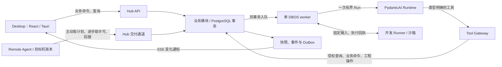

# CloudHelm 功能需求对齐与 Agent 及跨端接口架构评审

我的设计结论是：**保留 CloudHelm 的三端边界、模块化单体和单 DBOS worker；把 Agent 从“围绕一轮模型对话组织工具”，改为“围绕一个有明确输入、写入范围和验收条件的工作项组织执行”。** 然后围绕这条主线重新划分工具、候选读取、客户端查询和 Runner 接口。

这次复核里，有三个发现直接决定了改造顺序：

1. **构建端已经可以读取最终集成提交，验证和审查 Agent 的源码读取器却明确拒绝这一类候选。** 因此最有价值的第一项改动，是让审查者看到真正准备合入的代码。
2. **更换模型工具协议会影响用户可见的历史。** 现在不仅模型调用 `dispatch_tool`，Desktop 背后的工具时间线也只识别这个名字。只改 Gateway，会造成“新工具执行成功，界面却少了执行记录”。
3. **当前有可定位的额外开销，不需要先猜机器不够用。** Agent 装配上下文时持有数据库事务读取 Git；Agent 面板为生成列表会读取和解析多轮 SDK 历史；资源准入会在宿主池锁内读取已释放的历史预留。这三处都比直接增加 worker 更值得先处理。

> 评审日期：2026-11-19（Asia/Shanghai）；工作基线：`dev / b226022483fc`、计划修订 93，包含评审时已有的未提交工作树。
> 本文区分源码事实、已有证据与重设计建议，不替代 v4.7 总体设计、D01～D06 或阶段出口记录。此次评审采用只读方法，未启动服务、执行测试或发起收费模型验证。

## 1. 产品需求要先按“谁能证明结果”对齐

CloudHelm 有四个不同的用户目标：**完成开发、形成可交付版本、把版本部署到指定环境、让实际业务持续健康**。它们相关，但没有任何一个状态可以代替另外三个。今天的代码对这个原则有较好的基础，重设计应把它体现在每个接口和界面上。

| 用户需求 | 权威模块与应交付的结果 | 当前实际边界 |
|---|---|---|
| 创建或接入项目，规定谁可以做什么 | `identity` 持有身份、授权和策略；`projects` 持有项目与权威 Git 来源。用户应能知道当前安装支持哪种仓库、构建方式和目标环境 | 有项目查询、角色绑定、来源导入；创建项目仍是维护操作。不能把参照工程入口表现成已经支持任意仓库自助接入。[项目 API](../../services/hub-api/routes_projects.py#L1) |
| 把需求变成可以开发、可以验收的工作 | `collaboration` 持有 Task 和 WorkItem。工作项要说明目标、允许修改的范围、依赖哪个契约、交什么、由什么证据接受 | 已有 Task、工作项和接受命令；有角色模板不代表已有完整的需求澄清、自动分派和多 Agent 调度 |
| 让 Agent 修改真实项目 | `agent_runtime` 管 Session、Run、模型请求与费用；Gateway 控制工具；Workspace 和 Runner 产生文件、检查、进程与构建事实 | A11 证明固定便签参照的一次真实开发路径，包含模型修改、失败反馈、自测和构建。它不是任意项目、任意框架的能力证明 |
| 人可以接管修改，随后让 Agent 继续 | Workspace 持有写入权、代次、交出和交还快照。Agent 消费交还差异，由业务层重新判断原输入和证据 | 已有交权与失效的分项证据。关闭窗口、进程退出或人类说“改完了”，都不等于执行器已确认交还。[交权说明](../development/p2-handoffs.md) |
| 验证并合入真正要交付的版本 | `integration` 持有队列、集成尝试、正式验证、审查及证据适用性。`collaboration` 决定必需工作项是否接受、Task 是否完成 | E07d 有最终提交、真实制品、50 项独立 HTTP 检查、有权审查及项目内合入；原 Task 仍有一项必需工作阻塞，没有完成报告。“三角色制品”指前端、后端、PostgreSQL，不是三个开发 Agent |
| 选择是否人工试用 | 固定候选的人测轮次归 `integration`；临时环境及预览访问归 Workspace。人类结论、访问撤销、进程停止和磁盘回收是不同事实 | 当前宿主组合不列入本轮正式预览支持。E07e 六组正式隔离证据和 E04b 同轮资源收尾未执行；Windows 浏览器结果不能替代受支持的 Tauri/WebView2 产品链 |
| 形成 Release 并部署 | `artifacts` 核对制品；`delivery` 固定 Release、环境配置修订和部署计划；Remote Agent 持有目标机实际步骤账本 | 有独立目标接入、计划批准、首许可和部分归档。没有同一计划在独立目标完成迁移、服务更新和健康窗口的完整证据 |
| 发生事故后通知、调查、修复并确认恢复 | 运维领域持有观测、漂移和 Incident；修复 Task 从实际运行版本建立；恢复由关键业务探测的持续窗口证明 | 属于后续 P4/P5 的恢复及运维链。通知送达、容器存活、一次处置成功均不能代替业务恢复 |

这里我建议增加一个产品层面的改进：**在用户确认任务前，直接显示完成这个任务所需的能力，以及当前安装缺哪一项。** 例如“可修改受管源码、可按固定配方构建、正式 Windows 预览未获支持”。这些内容由安装能力、项目配方和任务策略投影出来，不另存一套可手工修改的“系统就绪”状态。若预览是这次任务的必需条件，就在启动前说明；若是可选项，就让其他获准工作继续。这样既减少无效模型开销，也不需要事后删掉必需项来制造完成。

当前阶段仍是 **P2 正式出口未通过，P3 等待**。尤其不能把 E07d 的合入、R05a 在副本上的工作项接受、R05b 用合成停止回执验证完成门禁，拼成一次从开发到完成的真实验收。[当前进度](../../PROJECT_PROGRESS.md#2026-11-19r04-与-r05b-出口核对) · [P2 出口逐项证据](../acceptance/p2/p2-r05b.md#阶段出口核对)

## 2. 目标架构保留三个部署端、四个信任边界

四个边界分别是 Desktop、Hub 控制面、开发执行区、远程交付机。开发执行区可以和 Hub 部署在同一台机器上，但生成的代码不应取得 Hub 数据库身份、宿主控制权限或远端部署凭据。独立 Runner 只是把这个边界移到另一台机器，不应新增一套业务调度器。



图里最重要的是三条调用规则：

- **API 不运行用户项目。** 命令处理器在一个短事务中核对权限和版本，写业务事实、事件、必要的 Outbox 和 DBOS 入队记录。事务提交后才允许执行模型、Git、Docker 或网络操作。DBOS 的事务入队正好支持这个边界，无需另设消息中间件来解决同库交接。[现有入队实现](../../modules/workflow/dispatch.py#L13) · [DBOS 官方事务入队说明](https://docs.dbos.dev/python/reference/client)
- **Agent 不持有业务决定权。** 它可以提出拆分、修改代码、解释失败、提交候选或建议返工。工作项接受、正式报告适用性、项目合入、部署批准、事故恢复分别由对应领域和有权人员决定。工具执行成功不能把这些状态顺便改掉。
- **远端不是一个听从 Hub 任意指令的开发 Runner。** 开发 Runner 服务于工作区、测试、构建和预览；Remote Agent 管理真实交付环境，在本地持锁、保存意图、按有限步骤执行。两者可以共用身份、摘要和回执的设计原则，不应共用一个“执行命令字符串”的接口。

面向对象在这里有三个适合使用的地方：**角色策略**决定一次 Run 的输入、工具和输出；**候选读取接口**封装两种真实源码来源；**执行器适配器**隔离本机开发执行与未来独立 Runner。普通业务命令继续使用现有应用服务和 `UnitOfWork`。我不会为每张表建 Repository、为每个角色建子类，或为每个模块拆一个服务：这些做法既没有解决当前边界问题，也会增加部署和排障成本。

## 3. Agent 的核心设计：长期身份、短时推进、独立操作

一次开发中要区分五个对象。用户看到的“Agent 正在干活”，实际上可能处于五种完全不同的阶段：

| 对象 | 它回答的问题 | 何时复用，何时新建 |
|---|---|---|
| `WorkItem` | 这项工作交什么，谁负责，什么证据才算接受？ | 后续修复同一工作项可以推进其修订；不能通过换 Run 逃避原验收要求 |
| `AgentSession` | 哪个角色在这个 Task 中延续工程上下文？ | 可以跨多个 Run；同时最多一个有效 Run。改变固定角色、模型或工具协议按兼容规则建新 Session |
| `AgentRun` | 这一次获准推进做了什么，因何结束？ | 崩溃恢复原 Run；可靠等待解决后新建 Run。Run 成功只代表这轮推进已提交 |
| `ModelRequestRecord` | 哪一次真实出站消耗了请求和预算？ | 每次真实 HTTP 尝试单独登记，包括 SDK 重试和校验修复导致的新请求；重放已知结果不增加一次收费请求 |
| `Operation` | 哪一个可能影响物理世界的意图正在执行？ | 构建、环境启动、文件变更等按原身份核对。网络超时、Run 更换或重收消息都不是重开物理操作的理由 |

例如，开发 Agent 提交构建后获得 `operation_id=B1`。若还能做独立工作，它可以继续；确实依赖结果时，才调用等待工具。若 B1 尚未结束，系统把合法消息历史、原 tool-call ID、等待条件和旧 Run 的结束一起提交，然后释放模型槽。B1 的确定回执到达时，再核对 Task 是否仍可推进、输入是否有效、Session 是否已有有效 Run，满足条件才续接。如果 B1 的进程状态未知，界面显示“等待核对原构建”，不能让模型看到一个伪造的失败结果并开始 B2。[可靠等待实现](../../modules/agent_runtime/operations.py#L163) · [PydanticAI 延迟工具协议](https://pydantic.dev/docs/ai/tools-toolsets/deferred-tools/)

### 角色按需求启用，工序不自动等于角色

| 角色 | 应读取什么 | 应交出什么 | 不能代替什么 |
|---|---|---|---|
| 协调 | 需求、验收修订、当前依赖、工作区归属和预算 | 小工作项、依赖与分配建议，附理由 | 不直接解锁依赖、不批准范围变化、不写目标分支 |
| 开发 | 当前工作项、允许修改的范围、源码基线、交还差异、返工证据 | 修改、开发自测、固定候选以及待验证项 | 不改独立验收资产，不凭自测关闭审查问题 |
| 验证 | 固定候选、确定的验收方法和环境、实际执行结果 | 正式报告引用，以及通过、失败、缺失、未知明细 | 不改候选，不把模型判断当作断言结果 |
| 审查 | 准确的最终差异、相关调用方、制品与验证事实 | 带文件、位置、原因和证据引用的问题，明确未覆盖范围 | 不填写人类 `approved`，也不因“没发现问题”自动合入 |
| 运维 | 实际运行版本、固定时间窗内的日志及探测、部署事实 | 调查结论、未知项、建议的受限处置或修复任务 | 不自主开启本机应急，不以处置命令成功判定恢复 |

默认用一个开发会话完成能独立验收的修改。P3 开放后，只有满足**输入契约明确、写入范围可分开、产物能独立交接、总预算允许**这四个条件，才增加开发会话。项目只有一条顺序依赖链时，多个 Agent 轮流转述上下文通常只会增加等待和费用。协调角色也不需要常驻：任务图在协作模块持久保存，只有出现拆分、冲突或返工决定时才需要推理。

这个选择借鉴了 [Anthropic 将 Session、模型循环和沙箱分离的设计](https://www.anthropic.com/research/managed-agents)，以及 [Google 对不同 Agent 组织方式的对照](https://research.google/blog/towards-a-science-of-scaling-agent-systems-when-and-why-agent-systems-work/)。我会保留本地锁定的 PydanticAI 和 DBOS，而不把托管 Agent 服务作为第二个执行核心。例如 [OpenAI 的托管 Agents API](https://developers.openai.com/api/docs/guides/agents-api/overview) 可以管理会话、编排、压缩和恢复，但这些职责在 CloudHelm 已经与本地权限、费用和物理操作身份绑定。整体引入后，最难的问题反而变成“两个系统对恢复给出不同判断时谁说了算”。仓库对 OpenHands 的[现有选型决定](../decisions/p2/agent-reuse.md#1-决定)也体现了同一取舍。

### 模型工具应当由一份类型定义产生

当前模型实际看到的是 `dispatch_tool(name, arguments: dict)`，参数 schema 另放在 prompt；注册、准入、上下文和处理入口还需要分别组合工具集合。我的建议是给每个已经存在的业务工具一份声明，只含真正需要的字段：

```text
业务动作：workspace.read_file
模型工具名：workspace_read_file
参数类型：现有 Pydantic 读取参数
适用角色：developer
性质：有界只读
处理入口：现有工作区读取服务
```

同一声明生成模型实际看到的参数、该 Session 可见的工具集合，以及历史展示名称。可用工具取**安装支持、角色上限、工作项范围和当前授权的交集**。模型不再自行填写可以从绑定得出的项目、主体或权限；会影响写入正确性的旧文件摘要、工作区版本等条件仍保留。SDK 在外部边界校验参数一次，领域服务继续检查“现在是否允许这次业务行为”。两种检查的目的不同。[现有通用分发](../../modules/tool_gateway/gateway.py#L24) · [上下文中的工具 schema](../../modules/agent_runtime/context.py#L160) · [PydanticAI 类型化工具](https://pydantic.dev/docs/ai/tools-toolsets/tools/)

这项改造有一个不可跳过的迁移顺序：**先让历史读取端能同时理解旧 `dispatch_tool` 和记名工具，再启用新 Session。** 当前时间线只从 `dispatch_tool` 的参数中提取业务名，也只收录同名工具返回。旧等待还必须收到与原 tool-call ID 匹配的结果，不能把历史正文批量改名。新工具定义是否节省 token，要看真实请求；把 schema 从 prompt 搬到工具区本身不构成节省证据。[历史解释逻辑](../../modules/agent_runtime/task_queries.py#L46)

### 上下文和费用也应有明确的停止条件

稳定前缀放角色约束、工具修订和项目规则；本轮增量放工作项、输入修订、必须阅读的源码范围、人工变更与反馈。大文件按固定引用有界读取，跨角色交接传候选和证据，不复制整段会话。当前实现已有 64 KiB 最终 prompt 和 256 KiB 业务 SDK 历史边界，不能通过静默截掉未完成工具调用来“压缩成功”。如果未来引入模型压缩，也要登记为真实模型请求。

同理，已知费用、未知预留和供应商账单分别保存。达到预算、时限或无进展门槛就交接，不自动扩额。当前还有一处小但具体的浪费：`query_operation` 每次返回新 `observed_at`，无进展判断只对 `workspace.check` 排除时间字段。建议对操作查询按**操作身份、业务状态、结果修订和证据摘要**判断是否有新进展，观察时间仍保留供审计。否则模型可能连续查到同一个结果，系统却认为每次反馈都不同。[无进展判断](../../modules/agent_runtime/development.py#L19)

## 4. 最优先的工程改动：让开发、构建、验证和审查看到同一交付对象

E07d 给出了一个很好的真实例子。开发候选是 `b948058e`，目标分支当时的提交是 `7ec1ab83`，项目队列准备出的最终集成提交是 `59e331eb`。这次两份文件清单恰好一致，**但开发候选和最终提交仍不是同一个 Git 对象**。目标分支多一个提交、出现一次三方合并差异，区别就会直接影响审查结论。[原始提交与队列记录](../acceptance/p2/p2-4-02-e07d.md#新安装和固定输入)

当前实现其实已经做好了一半：构建端能核对队列条目、尝试、项目与当前输入，打开受管 Git 的准确 commit，检查 manifest 和文件摘要；Agent 的候选读取器遇到 `integration-candidate-` 则直接返回不支持。我的方案是复用已有的**来源判定和内容校验依据**，增加一个只读入口，而不是重新造 Git 服务。[集成构建读取](../../modules/integration/merge_builds.py#L71) · [Agent 读取限制](../../services/hub-worker/engineering_verification.py#L72)

| 候选来源 | 只读入口如何解析 | 差异相对于谁 |
|---|---|---|
| Workspace 冻结候选 | 用原冻结 Operation、执行器回执、commit 和 manifest 打开不可变内容 | 该工作区候选登记的父提交 |
| 项目队列的最终候选 | 用项目、队列条目、准确尝试、最终 commit、manifest 和 InputSet 核对受管 Git | **该次尝试的目标基线**，不是任意当前分支或开发者本地分支 |

对上层只暴露三个动作：**列目录、按范围读文件、按页读差异**。每份返回带候选身份、commit、基线、内容摘要和截断标志。读一页源文件不应把构建器“读取整个项目并打包”的做法搬过来；两者共享真实性校验，不强迫使用相同的 I/O 粒度。读不到的二进制、大文件或未覆盖路径要进入审查报告的“未覆盖范围”。这也是采用窄接口的实际价值：两个生产者、两个消费者，有明确复用收益。

再以一个**拟议的 P3 场景**说明工作项怎么协作。假设需求是“便签列表支持按标签筛选，未传标签时保持原行为”：

1. 协调者先固定接口契约和验收标准，包括无标签、已知标签、未知标签三种结果。正式断言由独立验收来源维护，开发 Agent 不拥有修改权。
2. 后端工作项交付查询行为；前端工作项交付筛选交互。两者使用独立工作区，共享同一份契约修订，不共享可写目录。
3. 后端先完成时，前端可以消费已发布的契约和适用产物，不需要等整个 Task 完成。如果契约从单标签改成多标签，只把明确依赖旧契约的消费者标为需复核；其他项目或无关工作项继续。
4. 如果两个修改必须一起交付，应显式形成一个集成工作项，组合两个准确候选，再由项目队列生成最终提交。不能指望现有按条目推进的队列自动把两个半成品当作一次原子交付。
5. 验证者对最终制品和固定验收资产执行检查；审查者通过同一个最终候选读差异。审查发现问题时，返工记录绑定原位置、原候选和证据。开发者提交修复后，只有新候选的独立验证及必要复查才能关闭问题。
6. 合入前再次核对目标分支仍是当初的基线。若目标已移动，生成新集成尝试，旧报告保留历史，但不自动证明新提交。最后由 Task 完成命令检查所有必需项、同一最终输入的适用证据，以及尚未收尾的写操作。

这里需要保存两种不同的真相：**“旧报告当时通过”是历史事实；“旧报告能否证明今天这个候选”是当前适用性。** 更换基础镜像可能要求重做制品验证，却不必否定一份仅针对未变源码的审查；更换生产配置或 secret 版本通常要求重做部署计划与批准，却不应无理由重建相同镜像。明确区分这两种真相，才能在保证正确性的同时少做工作。[证据适用性规则](../design/01-domain-collaboration.md#9-工程引用输入集合与证据适用性)

## 5. 各端接口按使用场景重设计，删除重复取数和重复解释

我重新统计了当前两份 OpenAPI 3.1 快照：Hub 有 **82 条路径、85 个 HTTP 操作**；其中身份与项目 7、Task 与 Agent 11、工程／开发环境／资源／集成 35、预览与人测 18、交付 11、同步与存活 3。Remote 是 **8 条路径、8 个操作**。这个数字不含 Tauri IPC 和预览代理的数据通道。**我不建议设“砍到多少条路由”的指标**：有些路由代表不同授权或执行责任，删掉只会把复杂性藏进一个更难审计的请求体。

### Desktop 与 Hub：把列表、明细、命令回执分开

当前 `GET /api/tasks/{id}/agent` 会取最多 8 个 Session、每个最多 8 个 Run，还要取得相关 SDK 历史、提取工具结果、汇总费用与等待，之后才按输出上限裁剪。React 则用手写 `AgentView` 描述详细字段；后端契约的 `sessions` 本身是字典集合。直接生成 TypeScript 类型，只会把这份模糊继续传下去。[查询实现](../../modules/agent_runtime/task_queries.py#L89) · [后端响应契约](../../packages/contracts/p2/task_agent.py#L31) · [Desktop 类型](../../apps/desktop/src/types.ts#L12)

我建议的新契约如下，标为“新增”的均是设计，不是现有接口：

| 交互 | 建议 |
|---|---|
| 启动或继续 | 保留 `POST /api/tasks/{id}/agent-runs`。传工作项、必要版本和已批准预算约束；服务端装配角色、权限、输入及工具。返回的是排队回执 |
| 看任务面板 | 新增 `GET /api/tasks/{id}/agent-summary`。返回工作项、会话修订、最近 Run 状态、等待对象、阻塞原因和费用摘要。**此查询不读取完整 SDK 历史** |
| 查某轮做了什么 | 新增 `GET /api/tasks/{id}/agent-runs/{run_id}`。核对该 Run 属于当前 Task 后，仅展开该轮的工具结果、请求费用、操作和证据引用。大结果有界，不返回完整 prompt |
| 看代码 | 保留可变工作区的 `agent-diff`，明确标为“当前工作差异”；正式审查读取固定候选，并显示 commit。二者不能互相代替 |
| 兼容已有客户端 | 旧 `/agent` 保持原响应直到客户端迁移。先把摘要和明细定义成具体 Pydantic 类型，再从固定 OpenAPI 生成 TS 类型；例如可评估仅在构建时使用的 [openapi-typescript](https://openapi-ts.dev/introduction)。Tauri 的受限 IPC 和路由白名单仍保留 |

命令回执也有一处可以立即简化的契约。Rust 和 React 当前都尝试从 `body.command_id` 或 `body.task.command_id` 推断是否收到确定回执。建议改为：**Rust 完成本机日志持久化后，向 React 返回明确的可选 `receipt`；React 只管展示，展示后确认清理。** 已持久登记的业务拒绝可以有回执；网络中断且没有确定回执时，保留原键与原正文。服务端重新授权后，同键同摘要返回原结果；同键异摘要明确冲突。不能因用户重按按钮就产生第二次构建，也不能因为拿到 `202` 就显示“构建成功”。[原生回执判断](../../apps/desktop/src-tauri/src/bridge.rs#L141) · [业务身份与幂等规则](../design/02-execution-recovery.md#14-跨层身份和幂等契约)

### Desktop 同步与预览：减少刷新，不删除身份边界

- 当前命令回执、非空 SSE 批次、手动刷新都可能触发全项目快照。序号能防止旧响应覆盖新界面，却不能取消已经发生的数据库读取。建议同一账户、项目、流和权限修订只保留**一个在途刷新**；期间收到新变化，最多补一次尾随刷新。已知只影响某个 Task 或 Run 时，仅使对应视图失效；游标断裂、流变更或无法确定影响范围时才重建整份快照。
- 新范围可以从一致性快照的游标开始；同范围重连沿**最后实际消费的游标**续订。权限撤销、预览停止和撤销通知先处理本机收窗、清除旧视图，不等待普通刷新。SSE 是变化通知，权威详情仍按当前权限查询。
- 当前 `HumanTestOptions` 为“选择候选并开启人测”查询最近一轮环境并返回管理地址。最近一轮的地址不一定属于用户正选择的候选。建议新版选项只返回可测候选和测试者；选定具体轮次后，再从准确 `environment_id` 取得入口。移除的是一个会误导的字段和一次历史查询，不是预览能力。[当前选项查询](../../services/hub-api/routes_previews.py#L38)
- 原生 `preview_open` 仍只接受环境身份，并在打开前重新核对；不能因面板刚查过环境就取消这次检查。票据由可信管理页受保护地签发和兑换，不进 URL 或普通命令日志。Hub 已记撤销、本机已关窗、本机分区已删除、全部代理已关闭旧连接，是四种不同结果。

### Hub 与开发 Runner：先隔离构建接口，不先发明通用远程执行平台

当前真实拓扑是：Hub 接受意图并入队，唯一 worker 直接导入本机 `ControlledBuildRunner`；另有固定 Unix socket 连接 root ResourceHost，处理资源的接受、启动、查询、停止和受限网络动作。它不是一个已经支持任意独立节点的 Runner HTTP 服务。[构建执行入口](../../services/hub-worker/engineering_build.py#L115) · [本机资源通道](../../services/dev-runner/resource_channel.py#L12)

我会先固定三个行为：`submit(固定构建输入、原操作身份、预留引用)`、`inspect(原操作身份)`、`request_stop(原操作身份与代次)`。提交只表示已可靠接收；查询返回物理尝试、观察和制品证据；停止请求要等执行器证明停止后才释放冲突资源。light 档先用本机适配器接现有执行链，不增加进程。独立 Runner 后续可以实现同一业务契约，但必须单独证明执行身份、传输、资源账本和重启核对。**把 Python 调用包成一个接口，不等于已经实现跨主机隔离。**

### Remote Agent 与 Hub：八个现有操作基本应保留，先修复错误语义

| 通道 | 应保留的语义 |
|---|---|
| `bindings`、`observations` | 目标知道自己负责哪些绑定，主动报告实际状态。观测是事实，不是获准变更 |
| `poll`、`artifacts` | 拉取准确的批准计划及原 Operation，只取得计划引用的制品。取到计划不等于获准启动下一步 |
| `sample`、`permits` | 取得可信时间所需样本；每个新步骤在线检查计划、输入、执行器代次、前序结果和期限。不能用一次批准替代所有步骤许可 |
| `results`、`closeouts` | 步骤执行结果与整个原操作的封闭／停止回执分别提交。迁移结果未知就核对原迁移，不自动重做或回滚 |

真正需要改的是客户端错误处理：当前 JSON POST 只要不是 `200`，就可能统一变成 `remote_waiting_authorization`，而 Hub 已能区分认证失败、无效请求、门禁不可用和通道不可用。建议客户端只消费有界、已知的错误码：身份失效提示重新登记；输入或代次冲突要求核对；暂时不可达允许重连查询；已有本地执行意图时继续查询原结果。这样同样八个接口就能告诉维护人员**下一步该做什么**，无需再造一条 SSH 或 WebSocket 部署通道。[客户端处理](../../services/remote-agent/channel.py#L45) · [目标端步骤推进](../../services/remote-agent/runtime.py#L102)

外部 MCP 则只作为 Gateway 后面的工具适配器。MCP 描述工具怎么发现和调用；CloudHelm 决定这个项目、主体和 Run 现在能否使用它，以及这次调用属于只读查询、业务命令还是需要持久核对的副作用。无需把 Hub 内部的 Task、Git 合并和数据库命令全部网络化为 MCP 服务。[MCP 架构说明](https://modelcontextprotocol.io/docs/learn/architecture)

## 6. 低资源与高并发，要先设计“什么不占槽、什么不持锁”

同机 light 的设计预算为 **4 核、8 GiB**：常驻平台预留 2 GiB，系统与缓存 1 GiB，突发余量 1 GiB，全部开发执行共享最多 4 GiB 和 3000m CPU。独立 Runner 档的 Hub 仍按相同基线，执行节点另计。设计数量上限为两个活跃开发 Task、三个真实模型请求、每个共享宿主池初期一组重执行、一个按需预览。**一个 Run 默认最多三次请求、模型并发设计上限为三、当前 `models` 队列并发为一，是三个不同的数。** [资源规划](../design/03-workspace-build-resources.md#4-资源预留与组合任务) · [当前 worker 队列配置](../../services/hub-worker/runtime.py#L66)

我会优先处理以下四条可从源码定位的路径：

| 当前路径 | 目标设计 | 可以直接验收的变化 |
|---|---|---|
| Agent 在业务事务内装配上下文，持有 Task／Session／Run 相关锁时读取 Git | 第一个短事务固定授权范围、源码身份、commit、InputSet、控制与输入修订；事务外读取不可变内容；模型真实出站前复核当前资格。现有 Desktop diff 已有“取读规格→事务外读→复核”的本地先例 | Git I/O 不跨业务事务；读取期间发生交权或撤权时，没有新的模型出站。无需通过增加数据库连接缓解锁等待。[当前上下文](../../modules/agent_runtime/application.py#L93) · [已有实现先例](../../modules/agent_runtime/task_entry.py#L90) |
| 资源预留持宿主池锁，读取该池所有历史预留并解析 JSON；特定存储路径还逐条读取 Runner | 用已有唯一 `operation_id` 精确查询历史身份；容量计算只取仍占账的预留、保留占用和未知上界。身份去重与容量计算使用不同查询 | 增加已释放历史，不再让应用为每次新准入解析全部旧行；未知占用和保留磁盘仍会阻止超额准入。数据库是否需要补索引由固定数据的查询计划决定。[现有准入](../../modules/execution/commands.py#L58) |
| 普通界面更新会引发全快照和 Agent 历史展开；SSE 也使用 API 的单连接控制池做分批重鉴权 | 先合并刷新、拆摘要和详情，保留控制通道及撤权时效；不为每个在线窗口占一个 PostgreSQL 常驻连接 | 同范围只有一个在途快照；只看列表时完整 SDK 历史读取数为零；重负载下另测取消、撤权响应，而不只看首页平均延迟 |
| 构建、工作区、预览及合并等共享单槽 `engineering` 队列 | 物理重执行仍按宿主串行；等待人工、模型回复或已有操作结果不占重执行槽。若固定混合负载证明长构建挡住无关短操作，优先在同一 worker 内分出一条单槽长构建队列 | 一项重构建不会因队列拆分获得双倍物理额度；无关短操作有推进机会。执行器尚不能可靠接收和反查的动作，不丢到后台线程后提前报成功 |

举一个**仅用于解释算法**的数值例子：某宿主配置允许开发使用 4096 MiB，扣除平台保留后的本次实测可分配总量是 3600 MiB；已有占账 1500 MiB，尚未重复计入的未知占用上界 200 MiB，新构建申请 2200 MiB。总计 3900 MiB，超过 3600 MiB，就应等待。即使重执行队列空着，也不能启动。反过来，某个工作流结束但构建进程或磁盘回收未确认，同样不能释放对应额度。当前协议也不支持任意在线调额，不能把 D03 的完整调整设计写成现有能力。[容量核算规则](../design/03-workspace-build-resources.md#422-占账参与项) · [实际调额限制](../development/p1-resources.md#受管工程执行)

## 7. 失败、恢复和交付要靠固定身份处理，不能让模型临场决定重试

| 发生的事 | 系统应该怎么做 |
|---|---|
| Desktop 提交写命令后断线 | 本机保存原幂等键和正文；重连并重新授权后重投同一命令。若原结果已登记，返回原命令身份；不因为界面没有看到回执就再创建操作 |
| 模型请求已登记，响应或本地结果记录丢失 | 保留原请求身份和未知费用占账，核对提供方证据；恢复原 Run 不等于重发整轮请求。后续新请求必须重新获得预算 |
| 构建已启动，worker 重启 | 按原 Operation、尝试、预留和物理进程绑定查询。已有结果就补报；能证明安全停止才收尾；无法证明时继续占账，不能开冲突构建 |
| 人类在 Agent 准备修改时接管 | 接管先进入待确认；执行器确认旧写入者交出后，人类获得新代次。交还时固定前后快照、复核差异，旧 Run 的晚到修改不能进入新工作区 |
| 验证报告到达前，输入或目标分支已变化 | 原报告照实归档，对当前消费者标为需复核。不能把它选为新集成尝试的通过依据；也不把原来的通过历史改写成失败 |
| 撤销预览时某代理失联 | 已收到的关闭确认分别保存，缺确认的保持待核对。主窗口关闭、禁止新兑换和所有旧连接已关闭分别显示，不提前报告“访问已全部撤销” |
| 目标机迁移完成，但回执丢失 | 按原操作和具名步骤查询本地账本、实际数据库修订及后置检查。结果不明时保持核对；不因为 Hub 超时就再执行一次迁移 |
| 已批准 A→B，又有一个基于 A 的 A→C 计划 | B 若已经实施，C 的起始条件已变化。不能沿用对 A 的批准直接执行；重新固化基线、计划摘要和批准。已经运行的业务不依赖 Desktop 在线 |

对于 Release，建议始终分别呈现三样东西：**发布了什么制品、这个环境解析出什么配置、被批准执行的是哪份计划**。对 Incident，也分别呈现**渠道已接收、人员已确认、业务恢复窗口已满足**。这两处如果被压缩成一个绿色“成功”，即使底层记录齐全，产品仍会引导用户作出错误判断。[部署计划与基线变化](../design/04-release-deployment.md#5-deploymentplan-与起始基线) · [事故通知与恢复](../design/05-security-sync-operations.md#81-通知确认与恢复判定)

## 8. 实施顺序由当前证据决定，架构改造与阶段验收分别推进

| 顺序 | 建议交付的小切片 | 到什么程度才算这一步完成 |
|---|---|---|
| 当前阶段 | 按既有计划确认合格预览安装与固定输入，执行 E07e，再核对 E04b；另准备一个全部必需项有机会满足的真实任务 | 正式预览、物理回收、真实单 Agent 修复与完成各有对应证据。不改 E07d 原 Task，不把宿主范围调整记成通过 |
| 架构切片 1 | 打通最终集成候选的只读目录、文件、差异接口 | 构造开发候选与目标基线确有差异的实例；证明审查所读是最终 commit、差异相对准确基线、旧尝试不能替代新尝试。已有 E07d 结论只保留原适用范围 |
| 架构切片 2 | 工具定义归一，历史双读，新 Session 启用类型化工具 | 原等待按原 tool-call ID 续接一次；旧记录可展示；新工具的参数、授权、费用准入和展示均来自约定入口。先不改变所有角色和模型 |
| 架构切片 3 | 将 Git 内容读取移出业务事务；提供 Agent 摘要和按需明细；合并 Desktop 重复刷新 | 在相同输入下记录事务持有时间、查询量和控制响应。发生撤权时不会多发模型请求，发生事件突发时不会跳过实际消费游标 |
| 架构切片 4 | 优化资源账本读取，修正 Remote 错误分类 | 大量已释放历史不改变准入结果；未知和保留占账仍有效。远端能区分认证、状态冲突和暂不可达，断线后仍沿原 Operation 核对 |
| P3 开放后 | 在相同工具、模型、总预算、物理资源、验收资产和人工规则下比较单开发与双开发 | 报告独立验收成功率、错误依赖解锁、无效返工、控制与排队耗时、人工主动时间、已知及未知费用。保留失败和未完成样本，不只挑成功任务 |

兼容上采用**先读旧新两种格式，再启用新写入**。当前 Hub/Desktop 会核对准确的 API schema 修订；不能假设旧客户端会宽容接受新版响应。旧 Session 不原地更换协议，旧 DBOS 检查点不按新步骤顺序重放，旧 Remote 执行器不因 Hub 升级获得新能力。不具备兼容代码时，先停止新准入，在可核对边界完成切换；不能靠同时运行两个未经协调的 worker 过渡。[工作流兼容规则](../design/02-execution-recovery.md#12-工作流升级与恢复边界)

性能验收也要分两类。上述小切片只做能证明本次行为的窄验证；正式容量再按 D06 分别测 **4 核 8 GiB 同机 light** 和 **独立 Runner**，记录控制 P95、队列等待、连接占用、CPU／内存／磁盘峰值、清理后残留，以及规定的持续观察。现有 A11 归档有 16 个会话、60 个 Run、275 个真实请求，但没有完整账单和可比耗时，不能拿来承诺新架构会快多少或便宜多少。[单 Agent 基线](../acceptance/p2/p2-5-02.md#归档结果) · [分档容量与对照方法](../design/06-implementation-validation.md#10-两档部署容量测量方法)

**如果只批准一个架构切片，我选“最终候选可读”。** 它能复用已有 Git 和构建能力，不增加常驻服务，而且能用一句用户听得懂的话验收：**打开这次审查，看到的代码、独立验证的制品、批准合入的提交，三者能准确对应；任何一个版本改变，界面和完成门禁都不会继续沿用旧结论。**
